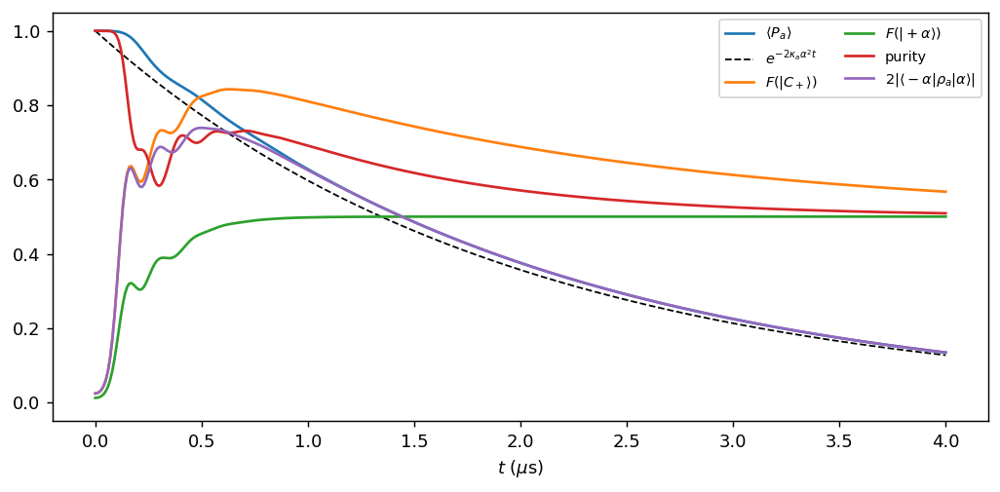
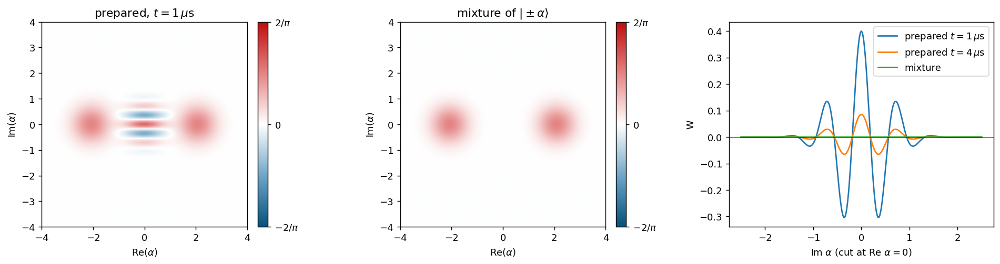
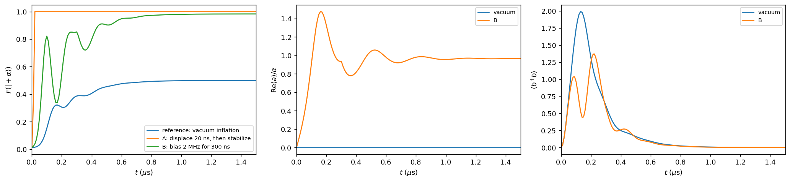
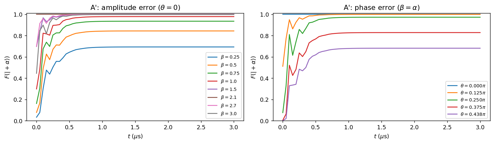

# Preparing a Cat Qubit in a Definite Logical State — Summary Report

**Introductory Track, Task 1 (DuQuantum 2026, Alice & Bob challenge).** Detailed derivations and every number are in `Task_1.0.md` – `Task_1.3.md`; the literature survey is in `../research_state_preparation.md`.

## Summary
Two-photon stabilization inflates the vacuum into the **even cat** $|\mathcal C_+\rangle\propto|\alpha\rangle+|-\alpha\rangle$, not into a computational state. This is forced by **photon-number parity conservation**: the cat then decays toward a mixture of $|\mathcal C_+\rangle$ and $|\mathcal C_-\rangle$ with a time constant of **1.95 µs**. To prepare $|0_L\rangle=|+\alpha\rangle$ we break the $a\to-a$ symmetry with a single-photon drive on the memory, and compared two protocols:

| Protocol | What it does | Fidelity with $\lvert+\alpha\rangle$ | Time |
|---|---|---|---|
| **A** | Displace the memory with a 20 ns pulse, then stabilize | **0.99998** | 20 ns |
| **B** | Bias drive while the cat inflates | **≈ 0.988** | ≈ 1 µs |

Protocol A is also robust to calibration errors (A′). Its amplitude can be off by about ±25% at no cost. Its phase is the critical calibration: it must be within about 22° for 0.999.

## Model
Memory $a$ and lossy buffer $b$:
$$H=g_2(a^2b^\dagger+a^{\dagger2}b)-\epsilon_d(b+b^\dagger),\qquad \text{jumps } \sqrt{\kappa_b}\,b,\ \sqrt{\kappa_a}\,a .$$
Parameters: $g_2/2\pi=0.763$ MHz, $\kappa_b/2\pi=2.6$ MHz, $\kappa_a/2\pi=9.3$ kHz, $\alpha=2.1$, $\epsilon_d=\alpha^2g_2$. Effective two-photon loss rate: $\kappa_2=4g_2^2/\kappa_b=2\pi\times0.896$ MHz.

We simulated with `dynamiqs`, in double precision, at truncation $N_a=24$, $N_b=12$, which Task 1.2 shows is converged.

## Groundwork (Tasks 1.0–1.2)

| Task | Key result | How we checked it |
|---|---|---|
| **1.0(a)** single-photon loss | $\langle n\rangle=4e^{-\kappa t}$; the state stays coherent, purity 1 | Agrees with theory to $10^{-8}$, which also confirms the $2\pi$ factors |
| **1.0(b)** pure two-photon loss | Photon number stalls at **0.49983** | Predicted $(1-e^{-8})/2$ from **parity conservation**: odd states fall to $\lvert1\rangle$, even states to $\lvert0\rangle$ |
| **1.0(c)** effective stabilization | Monotonic rise to 4.40 in about 250 ns; settling time $\propto1/\kappa_2$ | Curves collapse exactly vs $\kappa_2t$ when $\kappa_a=0$ (to $10^{-6}$) |
| **1.1** two-mode model | **Overshoot to 6.88 photons**, ringing, settles to 1% in 1.06 µs; buffer peaks at about 2 photons | Linear theory: $8g_2\alpha/\kappa_b=4.9>1$ means under-damped, with predicted period 0.319 µs (measured 0.316) |
| **1.2** semiclassics and convergence | Steady state 4.403 vs $\alpha^2-\kappa_a/2\kappa_2=4.405$ | Steady state is converged at any $N$; the overshoot needs $N_a\ge24$, $N_b\ge10$ |

**What carries over to Task 1.3:**
1. **Parity is conserved by everything except $\kappa_a$.** This decides which state the vacuum inflates into.
2. **The effective model fails for the transient.** Because the adiabatic-elimination condition is violated ($\epsilon_d/\kappa_b=1.3$), only the full two-mode model gives correct preparation dynamics.
3. **"Converged final value" ≠ "converged simulation".** The starter truncation $N_b=6$ gives a perfect steady state but an overshoot that is 11% too small. With $N_b=4$ the overshoot disappears entirely.

## Task 1.3(a) — What inflation from vacuum actually prepares

**The result is the even cat, and it is a superposition, not a mixture.**
- **$\langle a\rangle=0$ exactly** and $F(|+\alpha\rangle)\to0.5$: no well is selected, as $a\to-a$ symmetry requires.
- **The parity stays high:** $\langle P\rangle=0.63$ at 1 µs, whereas a 50/50 mixture of $|\pm\alpha\rangle$ has $\langle P\rangle=e^{-2\alpha^2}=1.5\times10^{-4}$.
- **The Wigner function shows fringes**, with negative values down to −0.30, and $W(0)=\tfrac{2}{\pi}\langle P\rangle$ (verified to five digits).

**Lifetime.** The parity decays with a time constant of **1.95 µs** (predicted $1/(2\kappa_a\alpha^2)=1.94$ µs).
- After the transient, the state is a $p\,\mathcal C_++(1-p)\,\mathcal C_-$ mixture with $p=(1+\langle P\rangle)/2$, which reproduces the measured $F(\mathcal C_+)$ and purity to <1%.
- The early purity dip (0.68 at 0.2 µs) has a different cause: entanglement with the briefly excited buffer.
- The best $F(\mathcal C_+)$ is **0.84**, at 0.63 µs.

## Task 1.3(b) — Preparing $|0_L\rangle=|+\alpha\rangle$

**Design principle.** We need a term that is *odd* in $a$, i.e. a memory drive. Projected onto the code space ($a\approx\alpha Z_L$):
- $\epsilon(a+a^\dagger)$ is a logical Z rotation, which can never select a well;
- $i\epsilon(a^\dagger-a)$ is a displacement along the real axis toward $+\alpha$.

So we use the second, and **its phase must be calibrated against the cat axis.**

### Protocol A — displace, then stabilize
A 20 ns pulse $i\epsilon_X(a^\dagger-a)$ (with $\epsilon_X/2\pi=16.7$ MHz, pump off) creates $|\beta=2.1\rangle$; then the stabilization is switched on.
- **$F_+=0.99998$ immediately, and constant over 3 µs.** The wrong-well population is below $10^{-5}$.
- **Why it works:** $|+\alpha\rangle$ is a dark state of the stabilization, and single-photon loss doesn't flip it.
- **Residual error:** the steady state is slightly smaller than $\alpha$, because of the $\kappa_a$ shift (Task 1.2).
- **Pulse length 10–100 ns:** no difference.
- **Pump left on during the pulse:** 0.99993.
- **No buffer transient:** $3\times10^{-5}$ photons, versus 2 photons when inflating from vacuum.

### A′ — robustness to calibration errors

| Error | $F_+$ after stabilization | Interpretation |
|---|---|---|
| amplitude $\beta=1.0$ / 1.5 / 2.1 / 2.7 | 0.978 / 0.9988 / 0.99999 / 0.9994 | the stabilization corrects the amplitude; the error is the weight starting in the wrong basin, $\approx\tfrac12\mathrm{erfc}(\sqrt2\beta)$ |
| phase $\theta=\pi/8$ / $\pi/4$ / $3\pi/8$ | 0.998 / 0.972 / 0.828 | phase is the critical calibration; the real basins are curved, so it costs more than a half-plane estimate predicts |

### Protocol B — bias drive during inflation
The stabilization stays on from $t=0$, and $i\epsilon_X(a^\dagger-a)$ is applied for the first $T_{\rm on}$.
- **Optimum around $\epsilon_X/2\pi=2$–3 MHz:**
  - weaker drives lose the race against the vacuum instability (about 40 ns): 0.90 at 1 MHz;
  - stronger drives overshoot the state to about 14 photons and push part of it across: 0.95 at 5 MHz.
- **Best result:** **$F_+\approx0.988$** at 2 MHz for 300 ns, and about 0.995 at 2 MHz for 1 µs. These values are at $N_a=32$–40; $N_a=24$ reads about 0.5% low, because B pushes the memory to high photon number.
- **While the drive is on, the well shifts** by $\delta\approx\epsilon_X/2\kappa_2\alpha^2$ (measured 0.27, estimated 0.25). It relaxes back in about 1 µs.

## Task 1.3(c) — Cost and trade-offs

| | **A: displace, then stabilize** | **B: bias during inflation** |
|---|---|---|
| Fidelity / time | **0.99998 / 20 ns** | ≈0.988 / ≈1 µs |
| Hardware | memory drive line, phase-locked to the pump (usually already present for Z gates) | same |
| Calibration | amplitude loose (±25%); phase ≤22° for 0.999 | drive strength has an optimum; same phase sensitivity |
| Interaction with stabilization | pump must be switched off then on, or left on at a small cost | pump never switched; wells deformed while driving |
| Photon numbers / buffer | ≈4.4 / no buffer transient | 10–14 / buffer transient ≈1.4 photons |
| Not modelled | pump switch-on transients, Stark shifts, finite rise time | drive-induced nonlinear processes and Kerr at high $n$ |

**Choosing between them.**
- **A** is simpler, faster and near-perfect in simulation, and it is the method used in experiments (Réglade *et al.*, *Nature* 2024; Putterman *et al.*, *Nature* 2025).
- **B** trades about 1% fidelity and about 1 µs for never switching the pump. That advantage is real in hardware but invisible to our model.

## Limitations and lessons
- **Not modelled:** square pulses only; no memory Kerr, thermal photons, pump transients or Stark shifts. Measurement-based preparation was considered but not simulated.
- **Fidelities are accurate only to about $10^{-4}$:** values slightly above 1 (up to 1.0002) come from solver tolerance with discontinuous pulses.
- **Truncation must be re-checked for each protocol.** $N_a=24$ is converged for vacuum inflation and for A, but not quite for B.
- **Purity alone is a misleading diagnostic.** Parity, $W(0)$ and $\langle a\rangle$ distinguish "superposition with phase flips" from "one well or the other".

*AI use: an AI assistant (Claude Code) drafted code, derivations and text and ran the simulations. The team has to verify every result before presenting it. Unverified citations are marked in the research file.*
