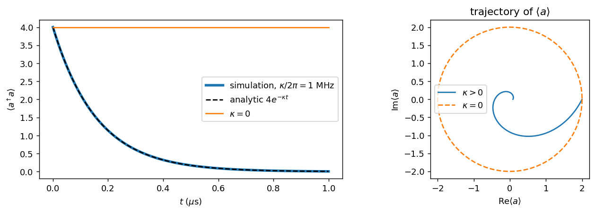
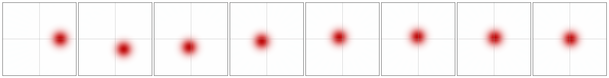
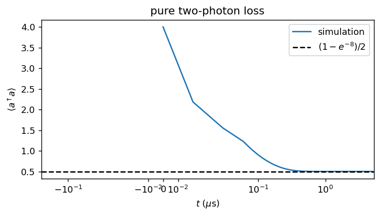
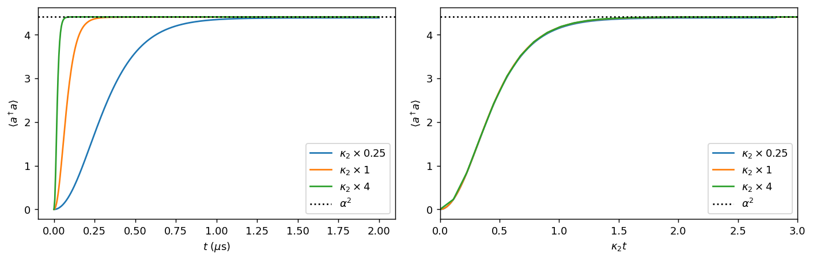
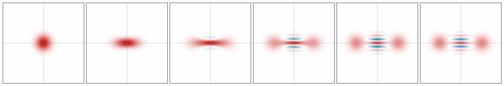

# Task 1.0 — Warm-up: adding dissipation one ingredient at a time

## Background

### What we are simulating
A **cat qubit** stores one qubit of information in a single microwave oscillator, called the **memory** (operator $a$). The two logical states are two coherent states with opposite phase:
$$|0_L\rangle\approx|+\alpha\rangle,\qquad |1_L\rangle\approx|-\alpha\rangle,\qquad \alpha=2.1 .$$
Their superpositions are **cat states**, $|\mathcal C_\pm\rangle\propto|\alpha\rangle\pm|-\alpha\rangle$.

Because $|+\alpha\rangle$ and $|-\alpha\rangle$ are far apart in phase space, noise has a very hard time turning one into the other. **Bit flips are exponentially suppressed.** Phase flips are not, so only one type of error remains to be corrected.

### The language we use

| Symbol | Meaning | Intuition |
|---|---|---|
| $\lvert n\rangle$ | Fock state: exactly $n$ photons | energy level $n$ of the oscillator |
| $a$, $a^\dagger$ | remove / add one photon: $a\lvert n\rangle=\sqrt n\lvert n-1\rangle$ | |
| $\langle a^\dagger a\rangle$ | mean photon number | the oscillator's energy |
| $\lvert\alpha\rangle$ | coherent state, $a\lvert\alpha\rangle=\alpha\lvert\alpha\rangle$ | a classical oscillation with amplitude and phase $\alpha$, plus minimal quantum fuzz |
| $\langle a\rangle$ | complex amplitude | position + momentum of a pendulum |
| $\rho$ | density matrix: the full state, possibly a statistical mixture | |
| $P=e^{i\pi a^\dagger a}$ | photon-number parity: +1 for even $n$, −1 for odd | $\langle P\rangle=\pm1$ for $\lvert\mathcal C_\pm\rangle$ |
| $W(x,p)$ | Wigner function, a picture of the state in phase space | a coherent state is a round blob at $\alpha$; a cat is two blobs plus interference fringes; negative values are a quantum signature |

### Equation of motion
Open systems obey the **Lindblad master equation**:
$$\dot\rho=-i[H,\rho]+\sum_k\mathcal D_{L_k}[\rho],\qquad \mathcal D_L[\rho]=L\rho L^\dagger-\tfrac12\{L^\dagger L,\rho\}.$$
- **$H$** is the reversible part.
- **Each jump operator $L_k$** is one irreversible process. For example, $L=\sqrt\kappa\,a$ means one photon leaks out at rate $\kappa$.

For any observable $O$ the same equation gives
$$\frac{d\langle O\rangle}{dt}=i\langle[H,O]\rangle+\sum_k\left\langle L_k^\dagger O L_k-\tfrac12\{L_k^\dagger L_k,O\}\right\rangle .$$
We use this repeatedly to derive analytic predictions.

### Units and parameters
$\hbar=1$, time is in µs and rates are in rad/µs, so $f$ in MHz becomes $2\pi f$.

| Parameter | Value | Note |
|---|---|---|
| $g_2/2\pi$ | 0.763 MHz | memory–buffer two-photon coupling |
| $\kappa_b/2\pi$ | 2.6 MHz | buffer loss |
| $\kappa_a/2\pi$ | 9.3 kHz | memory single-photon loss (the unwanted error) |
| $\alpha$ | 2.1 | target cat size, $\alpha^2=4.41$ |
| $\kappa_2=4g_2^2/\kappa_b$ | $2\pi\times0.896$ MHz $=5.63$ rad/µs | effective two-photon loss rate |

All simulations use `dynamiqs` in **double precision**. Task 1.0 uses a single mode truncated to $N=30$ Fock states.

---

## 1.0(a) Single-photon loss in physical units

**Setup.** $H=\Delta a^\dagger a$ with $\Delta/2\pi=1$ MHz, jump operator $\sqrt\kappa\,a$ with $\kappa/2\pi=1$ MHz, initial state $|\alpha_0=2\rangle$, $0\le t\le1$ µs.

### Prediction
From the observable equation above:

1. **Photon number.** $[H,n]=0$. For the dissipative part, use $a^\dagger n a=a^\dagger a^\dagger aa=n^2-n$, which follows from $aa^\dagger=a^\dagger a+1$, and $\tfrac12\{n,n\}=n^2$. Then
$$\frac{d\langle n\rangle}{dt}=\kappa\langle (n^2-n)-n^2\rangle=-\kappa\langle n\rangle\quad\Rightarrow\quad\boxed{\langle a^\dagger a\rangle=|\alpha_0|^2e^{-\kappa t}=4e^{-\kappa t}}$$
2. **Amplitude.** $[H,a]=-\Delta a$ and $a^\dagger aa-\tfrac12(a^\dagger aa+aa^\dagger a)=-\tfrac12a$, so
$$\langle a\rangle(t)=\alpha_0\,e^{-i\Delta t}\,e^{-\kappa t/2}.$$
This is a point spiralling into the origin, completing one turn per µs.
3. **The state stays coherent.** $a|\alpha\rangle=\alpha|\alpha\rangle$, so losing a photon doesn't change the *shape* of a coherent state, only its size: $\rho(t)=|\alpha(t)\rangle\langle\alpha(t)|$.

**Classical analogy.** This is exactly a damped pendulum. $e^{-i\Delta t}$ is the oscillation, $e^{-\kappa t/2}$ the friction, and the energy is the amplitude squared.

### Results

*Wigner snapshots at 8 evenly spaced times from 0 to 1 µs.*

| Check | Simulation | Prediction |
|---|---|---|
| max $\lvert\langle n\rangle_{\rm sim}-4e^{-\kappa t}\rvert$ | $1.5\times10^{-8}$ | 0 |
| $\langle a\rangle$ at $t=1$ µs | $0.086428+2\times10^{-9}i$ | $2e^{-2\pi i}e^{-\pi}=0.086428$ |
| $\langle n\rangle$ at $t=1$ µs | 0.00747 | $4e^{-2\pi}=0.00747$ |
| minimum purity $\mathrm{Tr}\rho^2$ over the run | 0.999996 | 1 |
| minimum fidelity with the predicted $\lvert\alpha_0e^{-i\Delta t-\kappa t/2}\rangle$ | 0.999998 | 1 |
| $\kappa=0$: range of $\langle n\rangle$ | 4.000 – 4.000 | 4, constant |

**Interpretation**
- Simulation and theory agree to solver precision ($10^{-8}$). This also confirms we converted units correctly. A missing $2\pi$ would give a rotation 6× too slow and a decay 6× too slow.
- The Wigner blob spirals inward **and stays round**. Purity stays 1, and the state is at every moment the predicted coherent state (fidelity > 0.99999). Single-photon loss shrinks a coherent state but never deforms or "blurs" it.
- With $\kappa=0$ the amplitude circles the origin once per µs at a constant $\langle n\rangle=4$, as the "What you should see" box predicts.
- Detail: the rotation is **clockwise**, since $\langle a\rangle\propto e^{-i\Delta t}$ for $H=+\Delta a^\dagger a$.

---

## 1.0(b) Pure two-photon loss

**Setup.** $H=0$, a single jump operator $\sqrt{\kappa_2}\,a^2$ with $\kappa_2=5.63$ rad/µs, initial state $|\alpha_0=2\rangle$, simulated for 5 µs (about $28/\kappa_2$).

### Prediction

**Which Fock states are untouched?** $a^2|n\rangle=\sqrt{n(n-1)}\,|n-2\rangle$, so
$$a^2|0\rangle=a^2|1\rangle=0 .$$
Both $|0\rangle$ and $|1\rangle$ are **dark states**. Every other $|n\rangle$ loses photons in *pairs*, so even states fall to $|0\rangle$ and odd states fall to $|1\rangle$.

**Parity is conserved.** $a^2$ changes $n$ by 2, so $Pa^2=a^2P$. Then
$$\frac{d\langle P\rangle}{dt}=\kappa_2\left\langle a^{\dagger2}Pa^2-\tfrac12\{a^{\dagger2}a^2,P\}\right\rangle=\kappa_2\langle Pa^{\dagger2}a^2-Pa^{\dagger2}a^2\rangle=0 .$$

**Plateau.** The final state lives in $\{|0\rangle,|1\rangle\}$, and all the odd-parity weight sits in $|1\rangle$:
$$\langle a^\dagger a\rangle_\infty=p_{\rm odd}=\frac{1-\langle P\rangle_0}{2}=\frac{1-e^{-2|\alpha_0|^2}}{2}=\frac{1-e^{-8}}{2}=0.49983,$$
using $\langle\alpha|P|\alpha\rangle=\langle\alpha|-\alpha\rangle=e^{-2|\alpha|^2}$.

### Results

| Check | Simulation | Prediction |
|---|---|---|
| $\langle n\rangle$ at 20 / 50 / 100 / 200 / 500 ns | 2.18 / 1.23 / 0.90 / 0.62 / 0.504 | fast initial drop, then stall |
| $\langle n\rangle$ at 5 µs | **0.499832** | $(1-e^{-8})/2=$ **0.499832** |
| final populations of $\lvert0\rangle,\lvert1\rangle$ | 0.50017, 0.49983 | $p_{\rm even},p_{\rm odd}$ |
| $\langle P\rangle$ at $t=0$ and $t=5$ µs | $3.3546\times10^{-4}$, $3.3546\times10^{-4}$ | conserved, $e^{-8}$ |
| initial weight already in $\lvert0\rangle,\lvert1\rangle$ | 0.0916 | $e^{-4}(1+4)$ |

**Interpretation**
- The photon number **drops quickly, then stalls** close to 0.5, matching the prediction to six digits. The drop is fast at first because the two-photon loss rate scales like $\kappa_2\langle a^{\dagger2}a^2\rangle\sim\kappa_2 n^2$, which collapses as $n$ shrinks. By 0.5 µs the state is essentially settled.
- **Answer to the question in the box.** $a^2$ leaves $|0\rangle$ and $|1\rangle$ untouched. Only **9.2%** of the initial coherent state was in them, yet the final state is **50/50**, so the plateau is *not* "the population that was left alone". It is set by **parity conservation**: every odd component is funnelled into $|1\rangle$ and every even one into $|0\rangle$. A coherent state with $|\alpha_0|=2$ is almost exactly half even and half odd.
- **Why this matters later (Task 1.3).** Two-photon processes cannot change parity. Whatever parity the memory starts with, it keeps. This single fact determines which state the cat qubit inflates into.

---

## 1.0(c) Stabilization: two-photon loss + two-photon drive (effective model)

**Setup.** Jump operators $L_2=\sqrt{\kappa_2}\,(a^2-\alpha^2)$ with $\alpha=2.1$, and $\sqrt{\kappa_a}\,a$. Initial state vacuum, $0\le t\le2$ µs. We repeat with $\kappa_2\to\kappa_2/4$ and $\kappa_2\to4\kappa_2$, all three in one batched `mesolve` call.

### Prediction
- **Steady states.** $L_2|\pm\alpha\rangle=\sqrt{\kappa_2}(\alpha^2-\alpha^2)|\pm\alpha\rangle=0$, so $|+\alpha\rangle$, $|-\alpha\rangle$ and every superposition of them are left untouched. That two-dimensional space is the qubit. Any other state is pushed toward it, so the photon number should settle near $\alpha^2=4.41$.
- **Which superposition?** $L_2$ also changes $n$ only by 0 or ±2, so parity is conserved. Vacuum has $P=+1$, so it inflates to the even cat $|\mathcal C_+\rangle$ (Task 1.3).
- **Why the settling time scales as $1/\kappa_2$, exactly when $\kappa_a=0$.** The equation is $\dot\rho=\kappa_2\mathcal D_{a^2-\alpha^2}[\rho]$. Substitute $\tau=\kappa_2t$:
$$\frac{d\rho}{d\tau}=\mathcal D_{a^2-\alpha^2}[\rho].$$
This contains no rate at all. So $\rho(t)=F(\kappa_2t)$ for a single universal function $F$: doubling $\kappa_2$ exactly halves every timescale and changes nothing else. With $\kappa_a\ne0$ there is a second dimensionless ratio, $\kappa_a/\kappa_2$, so the collapse becomes approximate.
- **Small shift of the plateau from $\kappa_a$.** The mean-field analysis of Task 1.2 gives $|\alpha_{\rm ss}|^2=\alpha^2-\kappa_a/(2\kappa_2)$, slightly below 4.41, and the shift is larger for smaller $\kappa_2$.

### Results

*Wigner snapshots at $t$ = 0, 20, 50, 100, 200, 500 ns, nominal $\kappa_2$.*

| $\kappa_2$ | $\langle n\rangle$ at 2 µs | prediction $\alpha^2-\kappa_a/2\kappa_2$ | monotonic? | $t_{90\%}$ | $t_{99\%}$ | $\kappa_2t_{90\%}$ |
|---|---|---|---|---|---|---|
| $\kappa_2/4$ | 4.387 | 4.389 | yes | 610 ns | 990 ns | 0.858 |
| $\kappa_2$ (nominal) | 4.404 | 4.405 | yes | 155 ns | 250 ns | 0.872 |
| $4\kappa_2$ | 4.408 | 4.409 | yes | 40 ns | 65 ns | 0.900 |

**Exact-scaling check.** Rerunning with $\kappa_a=0$ and comparing the three curves as functions of $\kappa_2t$, the largest difference is $1.5\times10^{-6}$ photons, which is solver tolerance. With $\kappa_a$ switched on the difference grows to 0.019 photons.

**Interpretation**
- $\langle n\rangle$ **rises smoothly and monotonically** and settles at about 4.40 within a few hundred ns: $t_{99\%}=250$ ns at the nominal $\kappa_2$. This matches the "What you should see" box.
- **Changing $\kappa_2$ changes how fast, not where.** The settling time scales as $1/\kappa_2$: $t_{90\%}$ goes 610 → 155 → 40 ns, a factor of about 4 each step, and $\kappa_2t_{90\%}\approx0.86$–$0.90$ is nearly constant. The plateaus differ by only 0.5%, and that difference is exactly the predicted $\kappa_a/2\kappa_2$ shift (table).
- The scaling argument is confirmed numerically: the collapse is *exact* when $\kappa_a=0$ and only approximate otherwise.
- **Wigner.** The vacuum blob stretches along the real axis and splits into two blobs at $\pm2.1$, with **interference fringes** between them, the hallmark of a cat superposition.
- **Side observation.** The parity at 2 µs has already fallen to $\langle P\rangle\approx0.37$ (nominal $\kappa_2$). Single-photon loss slowly turns $|\mathcal C_+\rangle$ into a mixture with $|\mathcal C_-\rangle$, which is the phase-flip error studied in Task 1.3.

This monotonic, non-overshooting curve is the "ideal" reference for Task 1.1.

---

## Notes, issues and lessons from Task 1.0
- **$2\pi$ conventions.** All parameters are quoted as frequencies and must be multiplied by $2\pi$. The agreement in 1.0(a) to $10^{-8}$ (one turn per µs, decay $e^{-2\pi}$ at 1 µs) is our explicit check that this was done correctly.
- **A wrong first guess, recorded honestly.** We initially expected the 1.0(b) plateau to equal the population that started in $|0\rangle,|1\rangle$ (9%). The simulation gave 50%, which led us to the parity-conservation explanation.
- **Numerics.** Double precision throughout. $N=30$ is ample here: a coherent state with $|\alpha|^2=4$ has negligible weight above $n\approx15$, and the cat with $\alpha^2=4.41$ is similar.
- **Tooling.** In `dynamiqs` 0.3.7 the solver options (`save_states`, `save_extra`, …) are direct keyword arguments of `mesolve`; there is no `options=` argument. We also turned off the progress bar (`dq.set_progress_meter(False)`), which otherwise floods the output.
