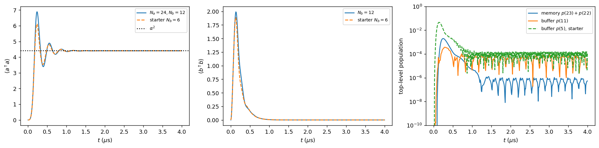
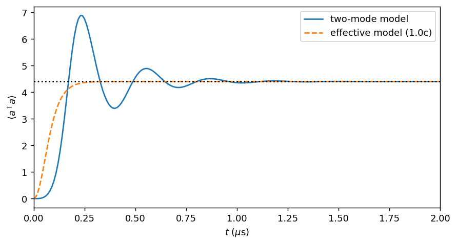
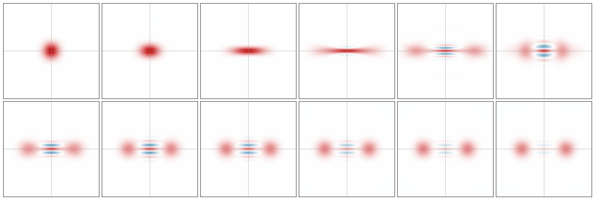

# Task 1.1 — The full two-mode model: inflating a cat

## Model

Instead of the effective jump operator $\sqrt{\kappa_2}(a^2-\alpha^2)$, we now simulate the physical mechanism (README B.8). The memory $a$ is coupled to a deliberately lossy **buffer** mode $b$:
$$H=g_2\left(a^2b^\dagger+a^{\dagger2}b\right)-\epsilon_d\left(b+b^\dagger\right),\qquad L_b=\sqrt{\kappa_b}\,b,\quad L_a=\sqrt{\kappa_a}\,a,\qquad \epsilon_d=\alpha^2g_2 .$$

How to read the terms:
- $a^2b^\dagger$ converts **two memory photons into one buffer photon**, and $a^{\dagger2}b$ does the reverse.
- $\kappa_b$ empties the buffer quickly, so pairs leaving the memory usually don't come back. This is the engineered two-photon *loss*.
- $\epsilon_d$ drives the buffer, and its photons are converted into memory pairs. This is the two-photon *drive*.
- The two balance at $a^2=\alpha^2$.

**Simulation choices**
- Initial state: vacuum in both modes. We simulate $0\le t\le4$ µs, twice the suggested 2 µs, to confirm the transient is over.
- Truncation: $N_a=24$, $N_b=12$, justified by the convergence study in Task 1.2. For comparison we also ran the README's starter truncation $N_b=6$.
- Storage: the full two-mode density matrix ($288\times288$) at 401 times would take about 0.5 GB. Instead, at each saved time we store only the **memory's reduced state** $\rho_a=\mathrm{Tr}_b\,\rho$ (a partial trace), about 4 MB in total. All memory quantities and Wigner plots come from $\rho_a$.
- Truncation monitor: we record the population of the **top two memory levels** ($n_a=22,23$) and the **top buffer level** ($n_b=11$), using projectors.

## Theory: what to expect, and why it can differ from Task 1.0(c)

Replace operators by their averages (the mean-field or semiclassical approximation) and use the observable equation from Task 1.0:
$$\dot a=-2ig_2\,a^*b-\tfrac{\kappa_a}{2}a,\qquad \dot b=-ig_2a^2+i\epsilon_d-\tfrac{\kappa_b}{2}b .$$

1. **At the start the buffer is driven hard.** With the memory empty, the buffer heads toward
$$b\to\frac{2i\epsilon_d}{\kappa_b},\qquad |b|^2=\left(\frac{2\epsilon_d}{\kappa_b}\right)^2\approx6.7\text{ photons}.$$
2. **Steady state.** Setting $\dot b=0$ gives $b=2i(\epsilon_d-g_2a^2)/\kappa_b$, and then $\dot a=0$ requires $a^2=\epsilon_d/g_2=\alpha^2$, with the buffer empty. This is the same steady state as the effective model.
3. **Small oscillations around the cat: over- or under-damped?** Write $a=\alpha+\delta a$, $b=\delta b$ and keep first order:
$$\dot{\delta a}=-iG\,\delta b,\qquad\dot{\delta b}=-iG\,\delta a-\tfrac{\kappa_b}{2}\delta b,\qquad G=2g_2\alpha .$$
This is a damped oscillator with characteristic equation $\lambda^2+\tfrac{\kappa_b}{2}\lambda+G^2=0$. There are two regimes:
   - **Over-damped**, when $G<\kappa_b/4$, i.e. $8g_2\alpha/\kappa_b<1$. The slow root is $\lambda\approx-2G^2/\kappa_b=-2\kappa_2\alpha^2$. That is exactly the effective model's relaxation rate, so this is the regime where Task 1.0(c) is valid.
   - **Under-damped**, when $8g_2\alpha/\kappa_b>1$. Then $\lambda=-\kappa_b/4\pm i\omega$ with $\omega=\sqrt{G^2-\kappa_b^2/16}$. Memory and buffer exchange photon pairs back and forth *coherently*, so the memory **overshoots and rings**.

**For our parameters:**

| Quantity | Value | Condition for the effective model |
|---|---|---|
| $g_2/\kappa_b$ | **0.29** | should be $\ll1$ |
| $\epsilon_d/\kappa_b$ | **1.29** | should be $\ll1$ |
| $8g_2\alpha/\kappa_b$ | **4.9** | should be $<1$ |

**The adiabatic-elimination condition $\kappa_b\gg g_2,\epsilon_d$ is not satisfied.** The linear analysis therefore predicts ringing with:
- period $2\pi/\omega=0.319$ µs;
- envelope $e^{-\kappa_bt/4}$, with rate $\kappa_b/4=4.08$ /µs and time constant 0.245 µs;
- settling to 1% after about $0.245\ln100\approx1.1$ µs.

## Results

### Photon numbers and truncation monitor

| Quantity | $N_a=24,\ N_b=12$ | starter $N_a=24,\ N_b=6$ |
|---|---|---|
| peak $\langle a^\dagger a\rangle$ (time) | **6.88** (230 ns) | 6.11 (230 ns) |
| $\langle a^\dagger a\rangle$ at 1 / 2 / 4 µs | 4.358 / 4.402 / 4.403 | — / — / 4.403 |
| 1% settling time of $\langle a^\dagger a\rangle$ | **1.06 µs** | |
| peak $\langle b^\dagger b\rangle$ (time) | **1.99** (130 ns) | 1.89 |
| $\langle b^\dagger b\rangle$ at 4 µs | $1.7\times10^{-5}$ | |
| max population in top 2 memory levels | $2.0\times10^{-3}$ | $9\times10^{-5}$ |
| max population in top buffer level | $3.7\times10^{-4}$ | **$4.6\times10^{-2}$** |

### Comparison with the effective model (Task 1.0(c))

### Checking the linear-response prediction
The successive extrema of $\langle a^\dagger a\rangle(t)$ fall at 0.23, 0.40, 0.55, 0.71, 0.87, 1.02, 1.18, … µs. Their distance from the final value decays as 2.48, 1.01, 0.49, 0.22, 0.11, 0.05, 0.024, …

| | measured | linear theory |
|---|---|---|
| ringing period | **0.316 µs** | **0.319 µs** (1% agreement) |
| decay rate of the oscillation | 4.7 /µs | 4.1 /µs ($\kappa_b/4$) |
| 1% settling time | 1.06 µs | ≈1.1 µs |

The period agrees to 1%. The decay rate is about 15% faster than predicted, because the first extrema are large deviations (2.5 photons) where the linearization is not accurate.

### Wigner snapshots of the memory (buffer traced out)

*Snapshots at $t$ = 0, 0.05, 0.1, 0.15, 0.23, 0.35 µs (top row) and 0.5, 0.7, 1, 2, 3, 4 µs (bottom row). Horizontal axis is $\mathrm{Re}\,\alpha$, vertical axis $\mathrm{Im}\,\alpha$; red is positive, blue negative.*

## Interpretation

**1. Overshoot and ringing: the main difference from the effective model.**
- In Task 1.0(c), $\langle a^\dagger a\rangle$ rose monotonically to 4.40. In the full model it **overshoots to 6.88**, which is 56% above $\alpha^2$, at 230 ns, then rings down and is within 1% of its final value after about 1.06 µs. All of this matches the "What you should see" box.
- **Why.** Early on, the buffer drive pumps the buffer toward about 6.7 photons. Those photons are converted into memory pairs faster than the buffer can leak them away, so the memory over-fills. Because $8g_2\alpha/\kappa_b\approx4.9\gg1$, the memory–buffer exchange is an *under-damped* oscillation rather than a one-way relaxation.
- The linear theory predicts the ringing period to 1% with no free parameters. That's strong evidence that the explanation is right.

**2. Buffer.**
- $\langle b^\dagger b\rangle$ peaks at about 2 photons at 130 ns, *before* the memory peak. This makes sense: the buffer fills first, then hands its photons to the memory.
- It then decays to essentially zero ($2\times10^{-5}$) at steady state. Once the memory sits at $a^2=\alpha^2$, the drive and the pair conversion cancel exactly in $\dot b$, so nothing feeds the buffer.
- **Why the starter truncation fails.** Two photons on average is a large fraction of the starter's $N_b=6$. In that run the top buffer level holds **4.6%** of the population during the transient, a clear red flag. With $N_b=12$ it stays below $4\times10^{-4}$.

**3. Same destination, different route.**
- Both models settle at 4.403. That is 0.16% below $\alpha^2=4.41$, which Task 1.2 explains as the effect of $\kappa_a$.
- The steady state is set by the dark-state condition $a^2|\pm\alpha\rangle=\alpha^2|\pm\alpha\rangle$, which doesn't care how fast the buffer is. Only the *transient* depends on the buffer dynamics.

**4. Wigner function.**
- **First 150 ns.** The vacuum blob is first **squeezed**, stretched along the real axis and narrowed along the imaginary axis, by the $a^{\dagger2}$ pair creation.
- **Splitting.** The stretched blob then splits into two lobes at $\pm\alpha$, with **interference fringes**: blue/red stripes on the imaginary axis between the lobes.
- **Overshoot.** During the overshoot (around 0.23 µs) the lobes sit beyond $\pm2.1$, and they then move back.
- **Fading.** Over several µs the fringes visibly **fade**: compare 1 µs with 4 µs. That is single-photon loss $\kappa_a$ causing phase flips, which mix $|\mathcal C_+\rangle$ with $|\mathcal C_-\rangle$. Task 1.3(a) quantifies it.

**5. Is 2 µs long enough?** Yes. $\langle a^\dagger a\rangle$ changes by only 0.0008 between 2 and 4 µs, which is 0.02%.

## Notes, issues and lessons from Task 1.1
- **The README's starter truncation $N_b=6$ is not adequate for the transient.** It underestimates the overshoot peak by 11% (6.11 vs 6.88), and its top buffer level reaches 4.6% population. Its steady state, however, is perfect (4.403). Checking only the final value would have hidden the problem. See Task 1.2.
- **Effective model vs full model.** The effective model is the right *steady-state* description but the wrong *transient* description for these parameters. This matters for anything time-resolved, for example gate durations or state-preparation times in Task 1.3.
- **Memory.** Storing full two-mode states was too heavy, as noted above. Storing only the reduced memory state, computed with `dq.ptrace` inside the solver's `save_extra` hook, fixed this. The README flagged `dq.destroy(Na, Nb)` and `dq.ptrace` as unverified. Both work in dynamiqs 0.3.7: `destroy(Na, Nb)` returns the tuple `(a, b)`, and `ptrace(rho, 0, (Na, Nb))` keeps the memory.
- **Wigner axis convention.** dynamiqs uses $\hbar=1/2$, so the axes are $\mathrm{Re}\,\alpha$ and $\mathrm{Im}\,\alpha$ and the lobes appear at $x=\pm2.1$.
