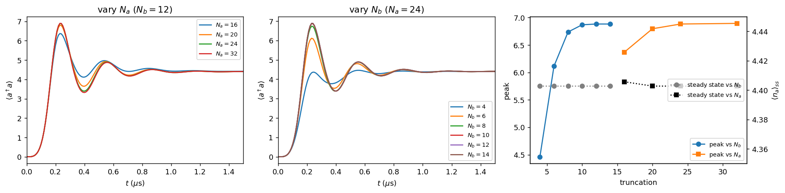

# Task 1.2 — Semiclassical sanity check and convergence study

## Part 1: semiclassical prediction vs simulation

### Theory
From the mean-field equations of Task 1.1,
$$\dot a=-2ig_2\,a^*b-\tfrac{\kappa_a}{2}a,\qquad \dot b=-ig_2a^2+i\epsilon_d-\tfrac{\kappa_b}{2}b,$$
set $\dot b=0$, which gives $b=2i(\epsilon_d-g_2a^2)/\kappa_b$. Inserting this into $\dot a=0$, for real $a$:
$$0=-\frac{4g_2}{\kappa_b}\,a\,(g_2a^2-\epsilon_d)-\frac{\kappa_a}{2}a\quad\Longrightarrow\quad a^2=\frac{\epsilon_d}{g_2}-\frac{\kappa_a\kappa_b}{8g_2^2}=\alpha^2-\frac{\kappa_a}{2\kappa_2}.$$

| Prediction | $\langle a^\dagger a\rangle_{\rm ss}$ |
|---|---|
| $\alpha^2=\epsilon_d/g_2$ (no memory loss) | 4.4100 |
| $\alpha^2-\kappa_a/2\kappa_2$ (with memory loss) | 4.4048 |
| **simulation** (two-mode, averaged over 3–4 µs) | **4.4027** |

### Interpretation
- The simulation is **0.16% below** $\epsilon_d/g_2$, far inside "a few percent", so there is no disagreement to explain away.
- The small deficit is a **real physical effect, not a numerical artifact**:
  1. It is identical, 4.4027, for *every* truncation we tried (table below), so it is not caused by the cut-off.
  2. Most of it, 0.0052 of the 0.0073, is explained quantitatively by single-photon loss: $\kappa_a$ constantly removes photons, so the balance point sits slightly inside $\alpha$.
  3. The remaining 0.002 (0.05%) is beyond mean-field theory. Quantum corrections from the cat's photon statistics are of this order, but we did not pin this residual down further.

## Part 2: convergence study

### Method
- **Two scans**:
  - $N_a\in\{16,20,24,32\}$ with $N_b=12$ fixed;
  - $N_b\in\{4,6,8,10,12,14\}$ with $N_a=24$ fixed.
- **Two quantities**:
  - the **steady state**, $\langle a^\dagger a\rangle$ averaged over $t\in[3,4]$ µs;
  - the **transient peak**, $\max_t\langle a^\dagger a\rangle$ during the overshoot.
- **Tolerances**, relative to the largest truncation in each scan: **0.1%** for the steady state and **0.5%** for the peak. The peak is a sharper, harder-to-converge feature, and 0.5% is well below anything visible on a plot.

### Results

**Scan in $N_a$ ($N_b=12$):**

| $N_a$ | steady state | peak | peak error vs $N_a=32$ | max pop. top-2 memory levels |
|---|---|---|---|---|
| 16 | 4.4057 (+0.07%) | 6.370 | −7.6% | $5.7\times10^{-2}$ |
| 20 | 4.4027 | 6.797 | −1.4% | $1.3\times10^{-2}$ |
| **24** | 4.4027 | **6.883** | **−0.16%** | $2.0\times10^{-3}$ |
| 32 | 4.4027 | 6.894 | — | $1.0\times10^{-3}$ |

**Scan in $N_b$ ($N_a=24$):**

| $N_b$ | steady state | peak | peak error vs $N_b=14$ | max pop. top buffer level | peak $\langle b^\dagger b\rangle$ |
|---|---|---|---|---|---|
| 4 | 4.4027 | **4.462** (no overshoot) | −35% | $1.9\times10^{-1}$ | 1.49 |
| 6 (starter) | 4.4027 | 6.115 | −11.2% | $4.6\times10^{-2}$ | 1.89 |
| 8 | 4.4027 | 6.738 | −2.1% | $8.6\times10^{-3}$ | 1.98 |
| **10** | 4.4027 | **6.869** | **−0.20%** | $1.5\times10^{-3}$ | 1.99 |
| 12 | 4.4027 | 6.883 | 0.00% | $3.7\times10^{-4}$ | 1.99 |
| 14 | 4.4027 | 6.883 | — | $1.8\times10^{-4}$ | 1.99 |

**Smallest converged truncation:**

| Quantity (tolerance) | smallest $N_a$ | smallest $N_b$ |
|---|---|---|
| steady-state $\langle a^\dagger a\rangle$ (0.1%) | **16** (the smallest tried) | **4** (the smallest tried) |
| transient peak (0.5%) | **24** | **10** |

### Interpretation: the two quantities are *not* equally sensitive

**The steady state hardly cares about truncation.**
- *Buffer:* at steady state it is essentially empty ($\langle b^\dagger b\rangle\sim10^{-5}$), so even 4 buffer levels describe it exactly.
- *Memory:* it holds a cat with mean photon number 4.4. Its photon distribution is roughly Poissonian, and the weight above $n\approx14$ is negligible, so 16 levels are enough.
- **The steady state is an attractor.** Even when the truncation distorts the transient (for $N_a=16$, 5.7% of the population sits in the top levels at the peak), the dissipation pulls the state back to the same final point. The error made on the way in is "forgotten".

**The transient peak is sensitive, mostly to $N_b$.**
- During inflation the buffer is strongly excited. It is driven toward about 6.7 photons and holds about 2 on average, with a broad distribution.
- If $N_b$ is too small, the buffer photons that would have been converted into memory pairs are **clipped**, and the overshoot shrinks.
- At $N_b=4$ the overshoot disappears entirely and the curve looks deceptively like the effective model of Task 1.0(c). An under-truncated simulation would have led us to the wrong physical conclusion.
- The memory also needs more room during the overshoot (about 7 photons, broader distribution), so $N_a=24$ is required, versus 16 for the steady state.

**Which truncation matters for what, physically.** $N_b$ controls the transient, because the buffer is only occupied while the cat is being inflated. $N_a$ matters a little for the transient (the memory overshoots) and very little for the steady state.

**Answer to "which starting truncation is too small?"** It is $N_b=6$. It gives the right steady state but an overshoot peak that is 11% too low.

**Our working choice:** $N_a=24$, $N_b=12$, which converges both quantities with margin. A 4 µs run takes about 50 s on a laptop CPU.

## Notes, issues and lessons from Task 1.2
- **Lesson: "converged final value" ≠ "converged simulation".** The steady state passes the convergence test at every truncation. Only the transient reveals that $N_b=6$ is wrong. Convergence must be checked on the quantity you actually report.
- **Monitoring top-level populations is a good early warning.** Every run whose peak was off by more than 1% had more than about 1% population in its top levels at some time. Every converged run stayed around $10^{-3}$ or below.
- **The same check applies to Task 1.3.** Protocols that drive the memory harder push it to higher photon numbers, and they need a larger $N_a$ (see Task 1.3).
- **Runtime scales steeply.** The density matrix has $(N_aN_b)^2$ entries: about 7 s for $(24,4)$ versus about 140 s for $(32,12)$. That is why we vary one truncation at a time.
