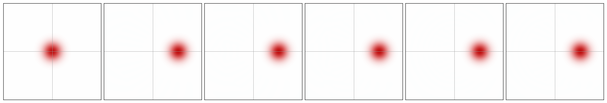
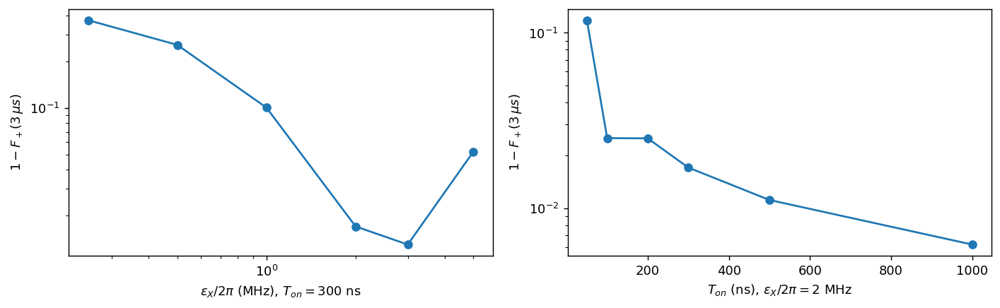
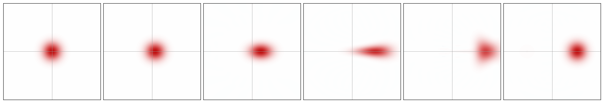

# Task 1.3 — Preparing a logical state

All simulations use the full two-mode model of Task 1.1 (memory + buffer, $\kappa_a$ included) with the provided parameters. The truncation is $N_a=24$, $N_b=12$ unless stated otherwise. "Fidelity with a pure target $|\psi\rangle$" means $F=\langle\psi|\rho_a|\psi\rangle$, where $\rho_a$ is the memory state with the buffer traced out.

---

## 1.3(a) Which state did we actually prepare?

### Analytic argument: memory parity is conserved
Let $P_a=e^{i\pi a^\dagger a}$ be the memory photon-number parity. We go through every term in the model.

| Term | Effect on $P_a$ | Why |
|---|---|---|
| $g_2(a^2b^\dagger+a^{\dagger2}b)$ | conserved | $a^2$ removes two photons, so $P_aa^2=a^2P_a$ |
| $-\epsilon_d(b+b^\dagger)$, $\sqrt{\kappa_b}\,b$ | conserved | act only on the buffer |
| $\sqrt{\kappa_a}\,a$ (single-photon loss) | **broken** | one photon lost flips parity |

For the last term, the observable equation from Task 1.0 gives, using $a^\dagger P_aa=-P_aa^\dagger a$:
$$\frac{d\langle P_a\rangle}{dt}=\kappa_a\left\langle a^\dagger P_aa-\tfrac12\{a^\dagger a,P_a\}\right\rangle=-2\kappa_a\langle P_a\,a^\dagger a\rangle\;\approx\;-2\kappa_a\alpha^2\langle P_a\rangle\quad(\text{once }\langle n\rangle\approx\alpha^2).$$

Therefore:
- **The vacuum has $\langle P\rangle=+1$**, and every engineered process preserves that.
- In the cat manifold $\mathrm{span}\{|\alpha\rangle,|-\alpha\rangle\}$, the only state with $P=+1$ is the **even cat** $|\mathcal C_+\rangle\propto|\alpha\rangle+|-\alpha\rangle$, i.e. $|+_L\rangle$. This is the two-mode version of the parity argument from Task 1.0(b).
- On longer times $\kappa_a$ randomly flips the parity, which mixes in $|\mathcal C_-\rangle$. The parity then decays as $e^{-2\kappa_a\alpha^2t}$, with predicted time constant $1/(2\kappa_a\alpha^2)=1.94$ µs.
- **Symmetry argument.** The model is symmetric under $a\to-a$, and so is the vacuum. The prepared state must keep this symmetry, so $\langle a\rangle=0$ exactly: the state cannot prefer one well over the other.

### How to tell a superposition from a mixture
Compare $|\mathcal C_+\rangle$ with the classical mixture "$|+\alpha\rangle$ or $|-\alpha\rangle$, 50/50", $\rho_{\rm mix}=\tfrac12(|\alpha\rangle\langle\alpha|+|-\alpha\rangle\langle-\alpha|)$. Both have two blobs at $\pm\alpha$, the same $\langle n\rangle$ and $\langle a\rangle=0$. The differences:

| Diagnostic | $\lvert\mathcal C_+\rangle$ | mixture | Why |
|---|---|---|---|
| parity $\langle P\rangle$ | +1 | $e^{-2\alpha^2}=1.5\times10^{-4}$ | $P\lvert\pm\alpha\rangle=\lvert\mp\alpha\rangle$, so $\langle P\rangle\approx2\,\mathrm{Re}\langle-\alpha\lvert\rho\rvert\alpha\rangle$: parity directly measures the **coherence** between the blobs |
| Wigner at the origin, $W(0)=\tfrac{2}{\pi}\langle P\rangle$ | $+2/\pi$, with fringes | ≈ 0, no fringes | in dynamiqs' convention the Wigner function at the origin *is* the parity |
| fidelity with $\lvert\mathcal C_+\rangle$ | 1 | 0.5 | |
| purity $\mathrm{Tr}\rho_a^2$ | 1 | 0.5 | ⚠ a mixture of $\lvert\mathcal C_+\rangle$ and $\lvert\mathcal C_-\rangle$ *also* has purity 0.5, so purity alone can't distinguish the two kinds of mixture. Parity can. |

### Results

| $t$ (µs) | $\langle P_a\rangle$ | $F(\lvert\mathcal C_+\rangle)$ | $F(\lvert+\alpha\rangle)$ | purity | $\lvert\langle-\alpha\lvert\rho_a\rvert\alpha\rangle\rvert$ | $\langle a\rangle$ |
|---|---|---|---|---|---|---|
| 0.1 | 0.998 | 0.30 | 0.15 | 0.987 | 0.152 | 0 |
| 0.2 | 0.963 | 0.60 | 0.31 | 0.681 | 0.295 | 0 |
| 0.5 | 0.815 | 0.82 | 0.45 | 0.704 | 0.369 | 0 |
| 1.0 | 0.628 | 0.81 | 0.498 | 0.691 | 0.312 | 0 |
| 2.0 | 0.375 | 0.69 | 0.500 | 0.570 | 0.188 | 0 |
| 4.0 | 0.134 | 0.57 | 0.500 | 0.509 | 0.067 | 0 |
| *mixture of $\lvert\pm\alpha\rangle$* | $1.5\times10^{-4}$ | 0.50 | 0.50 | 0.500 | | |

Further checks:

| Check | Simulation | Prediction |
|---|---|---|
| parity decay time (exponential fit, $t>1$ µs) | **1.946 µs** | $1/(2\kappa_a\alpha^2)=$ **1.940 µs** |
| $W(0)$ at $t=1$ µs | 0.39959 | $\tfrac{2}{\pi}\langle P\rangle=0.39959$ |
| $W(0)$ of the mixture | $9\times10^{-5}$ | ≈ 0 |
| most negative $W$ at $t=1$ µs | −0.30 | (mixture: never negative) |
| max $\lvert\langle a\rangle\rvert$ over the run | 0 (exactly) | 0 by symmetry |
| best $F(\lvert\mathcal C_+\rangle)$ | 0.84 at 0.63 µs | |

### Interpretation
1. **The prepared state is the even cat $|\mathcal C_+\rangle$, not a logical $|0_L\rangle$ or $|1_L\rangle$.**
   - $\langle a\rangle$ is exactly 0 throughout, so the state never picks a well.
   - $F(|+\alpha\rangle)\to0.5$: the state has equal weight in both wells.
   - Parity starts at +1 and is lost only through $\kappa_a$.
2. **It is a superposition, not a mixture.** At $t=1$ µs:
   - $\langle P\rangle=0.63$, about 4000× larger than any mixture of $|\pm\alpha\rangle$ can have.
   - The Wigner function has strong interference fringes with negative values down to −0.30.
   - $W(0)$ equals $\tfrac{2}{\pi}\langle P\rangle$ to five digits.
   - The coherence $|\langle-\alpha|\rho_a|\alpha\rangle|=0.312$ matches $\langle P\rangle/2=0.314$.

   The mixture shows the same two blobs but **no fringes** (middle panel and the cut in the right panel).
3. **What the imperfect purity means.** After the transient the state is, to a very good approximation, a mixture of the two cats: $\rho_a\approx p|\mathcal C_+\rangle\langle\mathcal C_+|+(1-p)|\mathcal C_-\rangle\langle\mathcal C_-|$ with $p=(1+\langle P\rangle)/2$. At 1 µs this gives $p=0.814$, which predicts $F(\mathcal C_+)=0.814$ and purity $p^2+(1-p)^2=0.697$. The simulation gives **0.810 and 0.691**.
   - So the purity loss is **phase flips** ($\mathcal C_+\to\mathcal C_-$), not a loss of the "both wells at once" character.
   - In the cat-qubit language: $\kappa_a$ randomly applies $Z_L$, which turns $|+_L\rangle$ into $|-_L\rangle$.
4. **Early purity dip (0.68 at 0.2 µs while $\langle P\rangle=0.96$).** This *cannot* be phase flips, since $p\approx0.98$ would predict a purity of about 0.96. It is **entanglement with the buffer** during the inflation transient. The memory and the strongly excited buffer (about 2 photons) are correlated, so tracing out the buffer leaves the memory mixed. The dip is temporary: once the buffer empties, the purity recovers to the value the parity predicts.
5. **How long it stays a superposition.** The coherence, measured by $\langle P\rangle$ or by the fringes, decays exponentially with a measured time constant of **1.95 µs**, versus 1.94 µs predicted.
   - Because the transient lasts about 0.5 µs and parity is already decaying during it, $F(\mathcal C_+)$ never exceeds **0.84** (at 0.63 µs). That is the best $|+_L\rangle$ this vacuum-inflation protocol can deliver with these parameters.
   - By 4 µs ($\langle P\rangle=0.13$) the fringes are almost gone.
   - Note: $1/(2\kappa_a\alpha^2)=1.94$ µs is the decay time of $\langle P\rangle$. The phase-flip *probability* grows at half that rate, $\kappa_a\alpha^2$, which gives the "$T_Z\approx3.9$ µs" quoted in some references. The two numbers describe the same physics.

---

## 1.3(b) Preparing a definite computational state, $|0_L\rangle\equiv|+\alpha\rangle$

### Design: we must break the $a\to-a$ symmetry
Two-photon stabilization is symmetric under $a\to-a$ and conserves parity. From a symmetric starting point it can *only* make $|\mathcal C_+\rangle$. To end up in one well we need a term that is **odd in $a$**, i.e. a **single-photon drive on the memory**, $\propto a$ or $a^\dagger$.

**Choosing the drive's phase.** Inside the cat manifold, $a\approx\alpha Z_L$, where $Z_L|\pm\alpha\rangle=\pm|\pm\alpha\rangle$. A memory drive can point in two directions:
- $H_X=i\epsilon_X(a^\dagger-a)$ generates a displacement **along the real axis**: $e^{-iH_Xt}=D(\epsilon_Xt)$. This pushes the state toward $+\alpha$, which is what we want.
- $H_Z=\epsilon_Z(a+a^\dagger)\to2\epsilon_Z\alpha Z_L$ in the code space. This displaces **along the imaginary axis** and is a logical Z rotation (the "Zeno gate"). It turns $|\mathcal C_+\rangle$ into $|\mathcal C_-\rangle$ but commutes with $Z_L$, so it can **never** change the populations of $|\pm\alpha\rangle$.

We therefore use the $i(a^\dagger-a)$ drive in both protocols. A practical consequence: **the drive's phase must be calibrated relative to the cat axis.** A 90° phase error converts the useful drive into a useless one. This is quantified below in A′.

### Protocols

| | Name | What we do | Idea |
|---|---|---|---|
| **A** | Displace, then stabilize | For $0<t<T_p$, pump and buffer drive **off** and the memory driven with $i\epsilon_X(a^\dagger-a)$, $\epsilon_XT_p=\beta=\alpha$. At $t=T_p$, stabilization on. | Turn vacuum into $\lvert+\alpha\rangle$ first. It is already a steady state of the stabilization, which then just holds it. This is the method used in experiments (Réglade *et al.* 2024; Putterman *et al.* 2025). |
| **A′** | Robustness of A | Start from $\lvert\beta e^{i\theta}\rangle\otimes\lvert0\rangle_b$, stabilization on, scanning the amplitude $\beta$ and the phase error $\theta$ | How precisely must the pulse be calibrated? |
| **B** | Bias during inflation | Stabilization **on** from $t=0$, starting from vacuum, plus $i\epsilon_X(a^\dagger-a)$ for $0<t<T_{\rm on}$ | Tilt the double well while the state is still near the origin and "deciding", so it rolls into the $+\alpha$ valley. The pump is never switched. |

**Metrics.**
- $F_+=\langle+\alpha|\rho_a|+\alpha\rangle$, the main figure of merit, and $F_-$, the population of the *wrong* well.
- $\mathrm{Re}\langle a\rangle/\alpha$, which is +1 for $|+\alpha\rangle$, 0 for a cat and −1 for the wrong well.
- The parity $\langle P\rangle$, which should drop from +1 to about 0.
- The buffer excitation.

All are evaluated at 1 µs and 3 µs after the start. Because the bit-flip time is extremely long (seconds in experiments), once the state is in a well it stays there. **$F_-$ is the preparation error.**

### Results: protocol A (displace, then stabilize)

*Protocol A, at $t$ = 0, 20, 50, 100, 200 ns and 1 µs. The 20 ns pulse moves the vacuum blob to $+2.1$, and it then stays put.*

| Variant ($\beta=\alpha=2.1$) | $F_+$(1 µs) | $F_+$(3 µs) | $F_-$(3 µs) | $\mathrm{Re}\langle a\rangle/\alpha$ | $\langle P\rangle$ | $F_+>0.999$ reached at | peak $\langle b^\dagger b\rangle$ |
|---|---|---|---|---|---|---|---|
| ideal (instantaneous) displacement | 0.99999 | 0.99999 | $5\times10^{-7}$ | 0.9992 | $2\times10^{-4}$ | 0 ns | $3\times10^{-5}$ |
| **20 ns pulse, pump off** ($\epsilon_X/2\pi=16.7$ MHz) | **0.99998** | **0.99998** | $8\times10^{-6}$ | 0.9992 | $2\times10^{-4}$ | 20 ns | $3\times10^{-5}$ |
| 10 ns pulse, pump off\* | 0.99999 | 0.99999 | $7\times10^{-6}$ | 0.9992 | | 10 ns | $4\times10^{-5}$ |
| 50 ns pulse, pump off\* | 0.99999 | 0.99999 | $7\times10^{-6}$ | 0.9992 | | 50 ns | $4\times10^{-5}$ |
| 100 ns pulse, pump off\* | 0.99999 | 0.99999 | $6\times10^{-6}$ | 0.9992 | | 100 ns | $6\times10^{-5}$ |
| 20 ns pulse, **pump left on**\* | 0.99990 | 0.99993 | $6\times10^{-5}$ | 1.0001 | $2\times10^{-4}$ | 470 ns | 0.063 |

\*These runs used $N_b=10$; the buffer stays essentially empty in protocol A.

**Interpretation, A**
- **Protocol A works essentially perfectly**: $F_+=0.99998$ as soon as the 20 ns pulse ends, and it stays there for the full 3 µs. The wrong-well population is below $10^{-5}$.
- **Why.** $|+\alpha\rangle$ is a dark state of the stabilization, so the stabilization has nothing to correct. Single-photon loss doesn't flip it either, since $a|\alpha\rangle=\alpha|\alpha\rangle$. Unlike $|\mathcal C_+\rangle$ in 1.3(a), this state does not decay on the µs timescale.
- **Residual error.** $\mathrm{Re}\langle a\rangle/\alpha=0.9992$, not 1, because the true steady state is slightly smaller than $\alpha$: $|\alpha_{\rm ss}|^2=4.403$ vs 4.41, from the $\kappa_a$ shift in Task 1.2. This accounts for most of the $10^{-5}$ infidelity.
- **Pulse length doesn't matter** between 10 and 100 ns, because $\kappa_aT_p\le6\times10^{-3}$: the unprotected memory barely loses anything during the pulse.
- **Leaving the pump on during the pulse also works** ($F_+=0.99993$), but it is slightly worse. The drive and the stabilization fight during the pulse, which briefly excites the buffer (0.06 photons) and deforms the state. It also takes longer (470 ns) to pass $F_+>0.999$.
- **A removes the buffer transient of Task 1.1 entirely.** The peak buffer occupation is $3\times10^{-5}$ instead of 2 photons, because the memory starts where $g_2a^2=\epsilon_d$.

### Results: protocol A′ (robustness to calibration errors)

*These scans use $N_b=8$, and all initial states are run in one batched call.*

**Amplitude error** ($\theta=0$):

| $\beta$ | $F_+$ at $t=0$ | $F_+$(3 µs) | $F_-$(3 µs) | half-plane estimate $\tfrac12\mathrm{erfc}(\sqrt2\beta)$ |
|---|---|---|---|---|
| 0.25 | 0.033 | 0.693 | 0.307 | 0.309 |
| 0.5 | 0.077 | 0.843 | 0.157 | 0.159 |
| 0.75 | 0.162 | 0.935 | 0.065 | 0.067 |
| 1.0 | 0.298 | 0.978 | 0.022 | 0.023 |
| 1.5 | 0.698 | 0.9988 | 0.0012 | 0.0013 |
| **2.1** | 1.000 | **0.99999** | $6\times10^{-7}$ | $1\times10^{-5}$ |
| 2.7 | 0.698 | 0.9994 | $6\times10^{-4}$ | ≈0 |
| 3.0 | 0.445 | 0.9977 | $2.3\times10^{-3}$ | ≈0 |

**Phase error** ($\beta=\alpha$, initial amplitude $\alpha e^{i\theta}$):

| $\theta$ | $F_+$ at $t=0$ | $F_+$(3 µs) | $F_-$(3 µs) | $\langle a\rangle$(3 µs) |
|---|---|---|---|---|
| 0 | 1.000 | 0.99999 | $6\times10^{-7}$ | 2.098 |
| π/8 (22.5°) | 0.511 | 0.9983 | 0.0017 | 2.091 |
| π/4 (45°) | 0.076 | 0.972 | 0.028 | 1.982 |
| 3π/8 (67.5°) | 0.004 | 0.828 | 0.172 | 1.376 |
| 7π/16 (78.75°) | 0.001 | 0.681 | 0.319 | 0.760 |

**Interpretation, A′**
- **The stabilization corrects calibration errors by itself.** Even a state with a poor initial overlap ends up in $|+\alpha\rangle$ if it starts in the right basin. Examples: $\beta=1.5$ has $F_+=0.70$ at $t=0$ and 0.9988 at 3 µs; $\theta=\pi/8$ goes from 0.51 to 0.9983. Note that $\langle a\rangle$ ends up real, so a phase error is *rotated back* onto the real axis.
- **The error is the weight that starts in the wrong basin.** For amplitude errors, the simple estimate "probability that the $x$-quadrature of $|\beta\rangle$ is negative", $\tfrac12\mathrm{erfc}(\sqrt2\beta)$, predicts $F_-$ remarkably well for $\beta\le1.5$ (0.307 vs 0.309, 0.022 vs 0.023, …). In this regime the boundary between the two basins is effectively the imaginary axis.
- **Tolerances that follow:**

| Target | Amplitude range ($\theta=0$) | Phase error ($\beta=\alpha$) |
|---|---|---|
| $F_+\ge0.999$ | $\beta\gtrsim1.6$, up to at least 2.7 | $\lvert\theta\rvert\lesssim\pi/8$ (22°) |
| $F_+\ge0.97$ | $\beta\gtrsim1.0$ | $\lvert\theta\rvert\lesssim\pi/4$ (45°) |

  The amplitude calibration is very loose: about ±25% around $\alpha$ costs nothing. **Phase is the critical calibration.**
- **Phase errors cost more than the half-plane estimate predicts.** At $\theta=\pi/4$ the state is still well inside $\mathrm{Re}>0$ ($\beta\cos\theta=1.48$), yet $F_-=2.8\%$, not the 0.1% that $\beta=1.48$ on the real axis gives. While the off-axis blob is being pulled back onto the real axis, the inflating dynamics stretch it, and part of it is pushed across. The real basins are curved, not half-planes.
- **Overshooting the amplitude is slightly harmful** ($\beta=3$: $F_-=0.2\%$). A large coherent state relaxes by emitting pairs through the buffer, and part of the state is thrown across. *Caveat:* $|\beta|^2=9$ is close to the regime where $N_a=24$ is marginal, and we did not check convergence for this point.

### Results: protocol B (bias drive during inflation)

*Protocol B with $\epsilon_X/2\pi=2$ MHz for 300 ns, at $t$ = 0, 20, 50, 100, 200 ns and 1 µs.*

*Fidelity with $|+\alpha\rangle$, $\mathrm{Re}\langle a\rangle/\alpha$ and buffer photon number for vacuum inflation, A and B.*

**Scan of drive strength** ($T_{\rm on}=300$ ns; scan used $N_a=24$, $N_b=10$):

| $\epsilon_X/2\pi$ | $F_+$(1 µs) | $F_+$(3 µs) | $F_-$(3 µs) | $\mathrm{Re}\langle a\rangle/\alpha$(1 µs) | peak $\langle a^\dagger a\rangle$ |
|---|---|---|---|---|---|
| 0.25 MHz | 0.626 | 0.629 | 0.371 | 0.25 | 6.9 |
| 0.5 MHz | 0.741 | 0.743 | 0.257 | 0.48 | 7.1 |
| 1 MHz | 0.896 | 0.899 | 0.101 | 0.79 | 7.9 |
| **2 MHz** | **0.980** | **0.983** | 0.017 | 0.95 | 10.0 |
| 3 MHz | 0.983 | 0.987 | 0.013 | 0.96 | 11.5 |
| 5 MHz | 0.939 | 0.948 | 0.052 | 0.88 | 13.8 |

**Scan of drive duration** ($\epsilon_X/2\pi=2$ MHz; $N_a=24$, $N_b=10$):

| $T_{\rm on}$ | $F_+$(1 µs) | $F_+$(3 µs) | $F_-$(3 µs) |
|---|---|---|---|
| 50 ns | 0.880 | 0.882 | 0.118 |
| 100 ns | 0.974 | 0.975 | 0.025 |
| 200 ns | 0.972 | 0.975 | 0.025 |
| 300 ns | 0.980 | 0.983 | 0.017 |
| 500 ns | 0.979 | 0.989 | 0.011 |
| 1000 ns | 0.786 (drive still on) | **0.994** | 0.006 |

**Truncation sensitivity.** The memory reaches 10–14 photons in protocol B, so $N_a=24$ is marginal. We reran a few points at larger $N_a$:

| Point | $N_a=24$ | $N_a=32$ | $N_a=40$ |
|---|---|---|---|
| 2 MHz, 300 ns | 0.983 | 0.9875 | 0.9877 |
| 5 MHz, 300 ns | 0.948 | 0.952 | — |
| 2 MHz, 1000 ns | 0.994 | 0.995 | — |
| 1 MHz, 300 ns | 0.899 | — | 0.903 |

The scans above therefore **underestimate $F_+$ by about 0.5%**. The best converged B result is **$F_+\approx0.988$** (2 MHz, 300 ns) and about **0.995** (2 MHz, 1 µs).

**Interpretation, B**
- **B works, but much less cleanly than A.** It reaches about 0.98–0.99 versus 0.99998. The wrong well keeps 1–2% of the population.
- **There is an optimum strength around 2–3 MHz.**
  - *Too weak* ($\le1$ MHz): the pump makes the vacuum unstable at a rate $\kappa_2\alpha^2\approx25$ /µs (about 40 ns), so the state "commits" to both wells before a weak bias can move it far enough.
  - *Too strong* (5 MHz): the drive throws the state far beyond $+\alpha$. The memory reaches about 14 photons, and $\mathrm{Re}\langle a\rangle/\alpha$ overshoots to about 1.5 even at 2 MHz (comparison figure). The violent relaxation that follows sends part of the state across the ridge.
- **A longer drive helps slowly** (0.975 → 0.983 → 0.989 → 0.994 for 0.1 → 1 µs) but costs time. While the drive is on, the state sits in a *shifted* well: at 2 MHz, $\mathrm{Re}\langle a\rangle/\alpha=1.13$. The size of the shift agrees with the estimate $\delta\approx\epsilon_X/(2\kappa_2\alpha^2)=0.25$ (measured 0.27). After the drive is switched off, the state takes several hundred ns to relax back.
- **The B dynamics are messy.** $F_+$ oscillates during the first 0.5 µs (comparison figure). The drive and the memory–buffer ringing of Task 1.1 interact, and the buffer shows a double peak (about 1.0 and 1.4 photons). The final value is only reached after about 1 µs, versus 20 ns for A.
- **What B buys you:** the pump and buffer drive never need to be switched. This avoids pump-switching transients and Stark-shift changes, which are not included in our model. Its main experimental appeal is therefore not captured by our simulation.

---

## 1.3(c) What does it cost?

### Summary comparison

| | **A: displace, then stabilize** | **B: bias during inflation** |
|---|---|---|
| Best fidelity with $\lvert+\alpha\rangle$ (simulated) | **0.99998** | **≈0.988** (300 ns), ≈0.995 (1 µs) |
| Time to final value | ≈ 20 ns (pulse length) | ≈ 1 µs |
| Extra hardware | memory drive line, phase-locked to the pump | same |
| Amplitude calibration | very loose: ±25% around $\alpha$ is free; $\beta\ge1$ already gives 0.98 | moderate: optimum 2–3 MHz, falls off on both sides |
| Phase calibration | important: ≤22° for 0.999, ≤45° for 0.97 | important: the same 90° failure mode applies |
| Pump switching | yes: pump off during the pulse, then on (or pump on, at a 7e-5 cost) | no |
| Buffer transient | none ($10^{-5}$ photons) | yes (≈1.4 photons) |
| Photon numbers reached | ≈ 4.4 | 10–14, which may excite unwanted nonlinear processes in a real device |
| Sensitivity to our model's missing physics | pump switch-on transients, Stark shifts | drive-induced well deformation, memory Kerr |

### Costs in detail

**Hardware.** Both protocols need a **drive line on the memory** at its frequency $\omega_a$. Cat-qubit devices usually already have one for the Zeno Z gate and for tomography (Réglade *et al.* 2024), so the cost is mostly in **control and calibration**, not new wiring.

**Calibration**
1. **Phase locking.** The cat axis is set by the pump and buffer-drive phases. The memory drive must be phase-locked to them and calibrated against the axis. A 90° error turns the drive into a Zeno (Z) rotation, which cannot prepare $|\pm\alpha\rangle$ at all. The A′ scan says this phase needs to be known to about 20° for 99.9%.
2. **Amplitude.** A coarse photon-number calibration (attenuation of the line), for example from a Wigner-function fit. Protocol A tolerates large errors.
3. **Frequency.** With the pump on, the memory frequency is AC-Stark-shifted. A drive at the bare frequency then slowly rotates relative to the cat axis. Protocol A with the pump off avoids this. Protocol B must use the shifted frequency.

**Interaction with the stabilization mechanism**
- *A, pump off during the pulse:* for about 20 ns the memory is unprotected. That costs only $\kappa_aT_p\approx10^{-3}$ in photon loss, which doesn't change the well anyway. The real cost is that switching the ATS pump on and off is not instantaneous: rise times, transients and frequency shifts are not in our model.
- *A, pump on during the pulse:* this avoids switching but costs a little fidelity (7e-5) and a small buffer excitation.
- *B:* the drive deforms the stabilized wells while it is on (shift $\delta\approx\epsilon_X/2\kappa_2\alpha^2$). The drive must be timed and switched off cleanly, and the state needs about 1 µs to settle.

**Physical limitations not included in our model** (see `research_state_preparation.md` §3)
- finite pulse bandwidth and rise times (we used square pulses);
- memory self-Kerr, which shears a displaced coherent state;
- pump-induced heating and thermal photons;
- spurious nonlinear processes in the ATS at high photon number, which are more relevant for B;
- calibration drifts over time.

Each would add an error that the stabilization partly corrects, as long as the state starts in the right basin. That is why the large basin margin of protocol A matters in practice.

### How this connects to the literature
Displacing the vacuum before (or while) turning on the stabilization is how dissipative cat experiments prepare $|0_L\rangle$/$|1_L\rangle$: Réglade *et al.*, *Nature* **629**, 778 (2024), arXiv:2307.06617, and Putterman *et al.*, *Nature* **638**, 927 (2025), arXiv:2409.13025. The bias-during-inflation idea (B) is inspired by bifurcation-based state selection in Kerr parametric oscillators: Goto, *Sci. Rep.* **6**, 21686 (2016); Puri *et al.*, *Nat. Commun.* **8**, 15785 (2017). We did not find a paper applying exactly protocol B to a dissipative cat. More background, and other options we did not simulate (measurement-based preparation, optimal control), are in `research_state_preparation.md`.

---

## Notes, issues and lessons from Task 1.3
- **Corrections to our first-draft claims.** These earlier statements in the notebook's markdown were wrong and are corrected here:
  - "$F(\mathcal C_+)\approx0.9$" → the actual maximum is **0.84**.
  - "phase errors up to π/4 cost almost nothing" → they cost **2.8%**.
  - "the erfc estimate only captures the trend" → it is **quantitatively accurate** for amplitude errors.
- **Protocol B is sensitive to the memory truncation.** Its strong drive pushes the memory to 10–14 photons. Values at $N_a=24$ are about 0.5% low compared with $N_a=32$ and 40, which agree with each other (0.9875 vs 0.9877). We report both. This is the same lesson as Task 1.2: a truncation that converges for one protocol need not converge for another.
- **The fidelity occasionally exceeds 1 slightly** (up to $1.0002$ in protocol A). This is numerical: the adaptive ODE solver's tolerance, combined with the discontinuous (square) pulse, leaves trace and positivity errors of order $10^{-4}$. Fidelities are therefore only meaningful to about $10^{-4}$, so "0.99998" should be read as "> 0.9998".
- **Purity is a misleading diagnostic on its own.** It cannot distinguish "both wells at once, with phase flips" from "one well or the other". Parity, $W(0)$ and $\langle a\rangle$ are the right tools.
- **Two different "phase-flip times".** $1/(2\kappa_a\alpha^2)=1.94$ µs is the decay time of $\langle P\rangle$. $1/(\kappa_a\alpha^2)=3.9$ µs is the inverse rate of phase-flip events. Both are correct; say which one you mean.
- **Scope.** We simulated protocols A, A′ and B. Measurement-based preparation (measure which well, then post-select or feed back) was considered but not simulated, nor was the Zeno-quadrature drive as a negative control. The analytic argument above explains why the latter cannot work.
